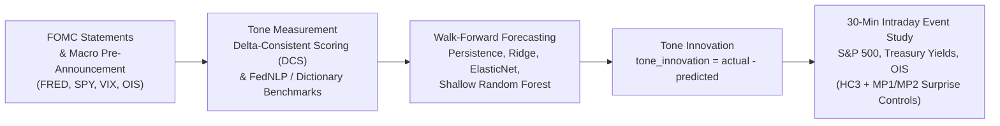
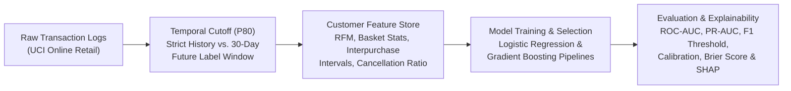

# Redouan Fekir — Quantitative Finance & Machine Learning Portfolio

*Quantitative Research • Natural Language Processing • Predictive Modeling • Financial Econometrics*

---

## Overview

Welcome to my project portfolio. My work focuses on **rigorous, leak-free empirical modeling** across financial markets and customer analytics—combining **Natural Language Processing (NLP)**, **out-of-sample time-series forecasting**, **high-frequency event studies**, and **interpretable machine learning pipelines**.

### Core Engineering & Research Principles
- **Strict Temporal Integrity:** Expanding walk-forward validation and percentile temporal cutoffs to prevent look-ahead bias and data leakage.
- **Econometric & Statistical Rigor:** HC3 heteroskedasticity-robust inference, futures-based policy surprise controls (`MP1`, `MP2`), probability calibration, and Brier score auditing.
- **Reproducible Architecture:** Modular Python packages, deterministic data pinning (commit hashes & file checksums), automated CLI pipelines, and unit/research-design test suites.

---

## Featured Projects

### 1. [Expected FOMC Tone and Market Reactions](https://github.com/rfekir24-cloud/fomc-tone-market-reactions)
> **Quantitative Macro & NLP Event Study** — Measuring whether financial markets react to the *unexpected* hawkish/dovish tone of Federal Reserve (FOMC) statements within a 30-minute intraday window.

#### Research Architecture

#### Key Highlights
- **Three-Stage Empirical Pipeline:**
  1. **Tone Quantification:** Continuous Delta-Consistent Scoring (`0 = dovish`, `1 = hawkish`) validated against FedNLP manual labels and transparent domain dictionaries (inflation, growth, policy stance).
  2. **Ex-Ante Tone Forecasting:** Expanding walk-forward out-of-sample predictions using only pre-announcement macro and market indicators (FRED policy rates, Treasury yields, VIX, broad dollar index, SPY momentum) to isolate true **tone innovations** ($\text{Tone Innovation}_t = \text{Actual Tone}_t - \widehat{\text{Expected Tone}}_t$).
  3. **High-Frequency Market Transmission:** 30-minute window regressions around FOMC releases using San Francisco Fed USMPD data (S&P 500, OIS, Treasury yields), controlling for futures-based monetary policy rate and path surprises (`MP1`, `MP2`) with HC3 robust standard errors.
- **Engineering Quality:** Full CLI package (`fomc-tone`), 5 modular research notebooks, YAML configuration + domain dictionaries, and 15+ unit & research-design tests verifying zero look-ahead leakage.

🔗 **[Explore Repository → `rfekir24-cloud/fomc-tone-market-reactions`](https://github.com/rfekir24-cloud/fomc-tone-market-reactions)**

---

### 2. [Online Retail Customer Engagement & 30-Day Retention Baseline](https://github.com/rfekir24-cloud/-Retail-Engagement-Project)
> **Predictive Customer Analytics & Explainable ML** — Leak-safe temporal pipeline predicting 30-day customer repurchase probability on the UCI Online Retail transactional dataset.

#### Pipeline Architecture

#### Key Highlights
- **Leak-Safe Temporal Split:** Uses the 80th percentile of `InvoiceDate` as a strict temporal cutoff—aggregating customer behavior strictly prior to the cutoff and labeling non-cancelled purchases in the subsequent `(cutoff, cutoff + 30 days]` window.
- **Rich Behavioral Feature Engineering:** Constructs customer-level Recency, Frequency, Monetary (RFM) metrics, basket size distributions, unique product diversity, unit-price statistics, interpurchase time intervals, and invoice cancellation ratios.
- **Calibrated Decisioning & Explainability:** Evaluates models across ROC-AUC, PR-AUC, optimal F1 precision-recall thresholds, reliability calibration curves, and Brier scores, paired with coefficient inspection, tree feature importances, and SHAP values.

🔗 **[Explore Repository → `rfekir24-cloud/-Retail-Engagement-Project`](https://github.com/rfekir24-cloud/-Retail-Engagement-Project)**

---

## Project Comparison Matrix

| Dimension | [Expected FOMC Tone & Market Reactions](https://github.com/rfekir24-cloud/fomc-tone-market-reactions) | [Online Retail Engagement Baseline](https://github.com/rfekir24-cloud/-Retail-Engagement-Project) |
| :--- | :--- | :--- |
| **Primary Domain** | Quantitative Macroeconomics, Monetary Policy, Asset Pricing | E-Commerce Analytics, Customer Retention, Behavioral Modeling |
| **Core Problem** | Do intraday equity & rate markets price *unexpected* FOMC statement tone? | Will an active customer complete a non-cancelled purchase in the next 30 days? |
| **Data Sources** | Federal Reserve, SF Fed USMPD (30-min intraday), FRED, Yahoo Finance, DCS, FedNLP | UCI Online Retail Transaction Logs |
| **Validation Strategy** | Expanding walk-forward time-series window | Temporal cutoff (80th percentile) + stratified customer holdout |
| **Models & Methods** | NLP Scoring (DCS/FedNLP), Ridge, ElasticNet, Random Forest, OLS with HC3 SEs | Logistic Regression, Gradient Boosting, Probability Calibration, SHAP |
| **Key Evaluation Metrics** | Out-of-sample MAE, $R^2$, HC3 $t$-stats, MP1/MP2 controlled $\beta$ | ROC-AUC, PR-AUC, Optimal F1 Threshold, Brier Score, Reliability Curve |

---

## Technical Stack

| Category | Tools & Libraries |
| :--- | :--- |
| **Languages** | Python 3.11+, SQL, Bash, Markdown / LaTeX |
| **Data & Econometrics** | `pandas`, `numpy`, `statsmodels` (HC3 robust inference, time-series regressions), `scipy` |
| **Machine Learning & NLP** | `scikit-learn` (Ridge, ElasticNet, Random Forest, Gradient Boosting, Calibration), `shap`, Delta-Consistent Scoring (DCS), FedNLP |
| **Visualization & Reporting** | `matplotlib`, `seaborn`, Jupyter Notebooks, automated Markdown/LaTeX table generation |
| **Software Engineering** | `pytest`, `pyproject.toml` packaging, CLI tooling (`argparse`/`typer`), Git, reproducible shell pipelines |

---

## Repository Contents

- [`README.md`](README.md) — Complete portfolio overview, project architecture diagrams, and links.
- [`index.html`](index.html) & [`assets/`](assets/) — Responsive, interactive web portfolio showcase (ready for GitHub Pages or local viewing).

---

**Redouan Fekir** • [GitHub `@rfekir24-cloud`](https://github.com/rfekir24-cloud) • [r.fekir24@gmail.com](mailto:r.fekir24@gmail.com)

