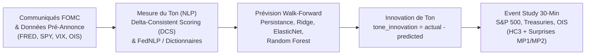
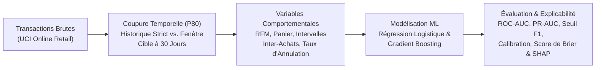

# Redouan FEKIR — Portfolio Ingénierie Financière de Marché, Quant & Data

**Master 2 Ingénierie Financière de Marché – Université de Lorraine (Metz, France)**

📍 Metz, France • 📞 +33 (0)7 54 59 06 33 • 🌐 **[Accéder au site web interactif du Portfolio](https://rfekir24-cloud.github.io/portfolio/)**

---

## À propos

Étudiant en **Master 2 Ingénierie Financière de Marché** à l'**Université de Lorraine**, je me spécialise dans la **finance quantitative de marché**, l'**économétrie des séries temporelles financières** et la **Data Science / Machine Learning appliqué**. Mes travaux allient rigueur économétrique, absence stricte de biais d'anticipation (*look-ahead bias*) et automatisation de pipelines analytiques (Python, SQL, RStudio, EViews, Power BI).

---

## Projets GitHub & Code

### 1. [Expected FOMC Tone & Réactions de Marché](https://github.com/rfekir24-cloud/fomc-tone-market-reactions)
> **Macro-Finance Quantitative, NLP & Étude d'Événements Intrajournalière (30 min)**

- **Mesure du ton monétaire :** Score continu Delta-Consistent Scoring (`0 = dovish`, `1 = hawkish`) validé face aux annotations FedNLP et à des dictionnaires transparents.
- **Prévision hors-échantillon (Walk-Forward) :** Prédiction du ton attendu uniquement avec l'information disponible avant l'annonce (taux FRED, VIX, rendements obligataires, dollar, SPY) afin d'isoler l'**innovation de ton** ($\text{Tone Innovation}_t = \text{Actual Tone}_t - \widehat{\text{Expected Tone}}_t$).
- **Transmission de marché à 30 minutes :** Régressions haute fréquence sur les données SF Fed USMPD (S&P 500, OIS, Treasuries) avec erreurs standards robustes HC3 et contrôle des surprises de taux à terme (`MP1`, `MP2`).

🔗 **[Voir le dépôt → `rfekir24-cloud/fomc-tone-market-reactions`](https://github.com/rfekir24-cloud/fomc-tone-market-reactions)**

---

### 2. [Prédiction de l'Engagement Client à 30 Jours (Online Retail)](https://github.com/rfekir24-cloud/-Retail-Engagement-Project)
> **Machine Learning Prédictif, Feature Engineering Comportemental & Explicabilité SHAP**

- **Séparation temporelle sans fuite (*Leak-Safe*) :** Utilisation du 80e centile de `InvoiceDate` comme date de coupure pour construire l'historique client et prédire le réachat non annulé sur `(cutoff, cutoff + 30 jours]`.
- **Modélisation calibrée :** Comparaison Régression Logistique vs. Gradient Boosting (ROC-AUC, PR-AUC, seuil F1 optimal, courbe de calibration, score de Brier) et interprétation via **SHAP**.

🔗 **[Voir le dépôt → `rfekir24-cloud/-Retail-Engagement-Project`](https://github.com/rfekir24-cloud/-Retail-Engagement-Project)**

---

## Thèse & Projets Académiques

- **Thèse de Master 2 IFM (Université de Lorraine) :** *Analyse quantitative et comparative des indicateurs de performance et de risque des ETF Sectoriels par rapport aux ETF Indiciels.*
- **Économétrie des Séries Temporelles (Université de Lorraine) :** *Analyse de l'impact du taux effectif des Fonds Fédéraux (FFER) sur le crédit, l'investissement et la stabilité financière mondiale à l'aide de modèles ARIMA et VAR et prévisions de volatilité via ARCH/GARCH.*
- **Étude de Recherche et d'Analyse (Université de Lorraine) :** *L'impact de la directive CSRD (Corporate Sustainability Reporting Directive) sur la performance financière des entreprises européennes.*

---

## Expériences Professionnelles

| Période | Poste | Entreprise & Lieu | Missions clés |
| :--- | :--- | :--- | :--- |
| **Janv. 2026 – Juin 2026** | **Analyste Investigations Criminalité Financière & Économique** | **Attijariwafa bank** (Casablanca, Maroc) | Surveillance des transactions (100+ flux), détection blanchiment/fraude (30+ dossiers clients), revues AML/KYC (100+ profils), échanges autorités (5+ cas/j) et 10+ rapports de direction. |
| **Mars 2025 – Juil. 2025** | **Assistant Data / Business Analyst – Automatisation & Reporting** | **TechIndus Solutions** (Strasbourg, France) | Automatisation du traitement de données de production (**Python, SQL**), dashboards interactifs **Power BI** (OEE, arrêts machine, taux de défaut), gestion de projet métier/technique. |
| **Sept. 2024 – Aujourd'hui** | **Employé Polyvalent de Magasin** | **LIDL FRANCE** (Metz, France) | Approvisionnement, gestion de la qualité, contrôle du respect des procédures et normes légales. |
| **Avril 2022 – Juin 2022** | **Stage de Recherche** | **GATE – CNRS (UMR5824)** (Saint-Étienne, France) | Étude sur l'évolution de la **Blockchain** : expansion de la *Proof of Stake (PoS)* et mesures de sécurité face à la criminalité dans l'univers des cryptomonnaies. |
| **Juin 2021 – Août 2021** | **Assistant Chargé d'Affaires Entreprises** | **Banque Centrale Populaire – Centre d'Affaires** (Oujda, Maroc) | Gestion d'un portefeuille corporate international, analyse du risque, revue **KYC**, montage de dossiers de crédit et suivi des flux. |
| **Janv. 2021 – Mars 2021** | **Assistant Comptable et Financier** | **Fiduciaire TIB COMPT** (Oujda, Maroc) | Opérations comptables, élaboration du bilan, analyse financière et conformité fiscale. |

---

## Formation

- **2023 – 2026 | Master 2 IFM – Ingénierie Financière de Marché** — *Université de Lorraine (Metz, France)*
  - Évaluation des actifs financiers, Modèles stochastiques pour la finance de marché, Théorie de la finance, Économétrie des séries temporelles financières, Gestion de portefeuille, Options et produits dérivés, Enjeux réglementaires en finance.
- **2022 – 2023 | Master 1 Analyse et Politique Économique** — *Université Jean Monnet – Saint-Etienne School of Economics (Saint-Étienne, France)*
  - Data Management & Information Systems, Économétrie d'évaluation des programmes, Économie monétaire et bancaire, Théorie des graphes, Théorie de la décision.
- **2018 – 2022 | Licence en Économie Appliquée** — *Université Jean Monnet – IAE Saint-Etienne (Saint-Étienne, France)*
  - Économétrie, Statistique Inférentielle, Business Intelligence, Finance Internationale, Finance d'entreprise, Recherche Opérationnelle.

---

## Compétences & Langues

- **Programmation, Économétrie & BI :** Python, SQL, RStudio, EViews, VBA, Power BI, Tableau, LaTeX, SAP BO, ODOO, Office 365
- **Langues :** Français (Courant) • Anglais (Courant) • Arabe (Langue maternelle)
- **Activités :** Musculation, Natation, Volontariat, Sports Automobiles
